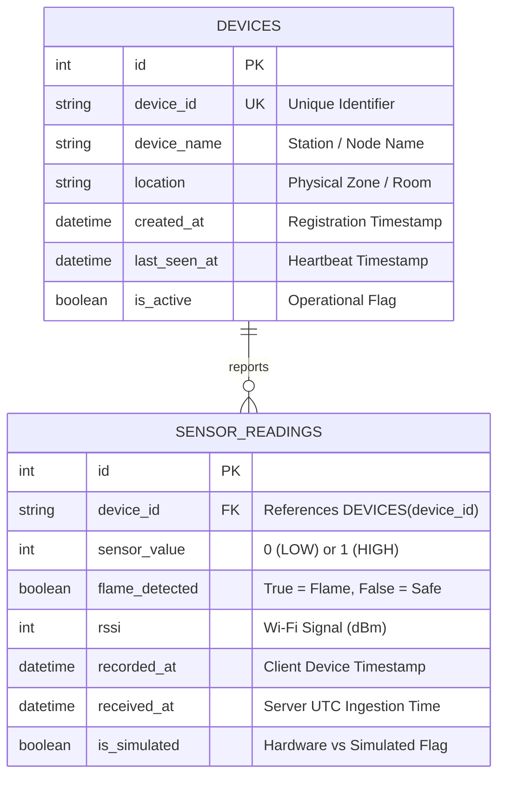

# MCA Academic Project Report Outline
## IoT-Based Intelligent Fire Detection & Real-Time Monitoring System

---

## Abstract

Fire hazards pose catastrophic risks to human life, property, and industrial infrastructure. Traditional smoke and thermal alarm systems often introduce delayed responses or require complex wired backbones, lacking centralized telemetry and real-time remote visibility. This project presents the design, implementation, and cloud deployment of an **IoT Fire Detection System** featuring an **ESP32 DevKit V1 microcontroller**, an optical **Infrared (IR) flame sensor**, a containerized **Python FastAPI backend**, a managed **PostgreSQL datastore**, and a responsive **React/Tailwind web dashboard**. 

The hardware layer adopts active-LOW digital detection logic with immediate local visual indicators (dual Red/Green LEDs) guaranteed by non-blocking firmware routines. Telemetry packets containing sensor status, pin logic, device identifiers, and Wi-Fi signal strength (RSSI) are transmitted via HTTP POST with API-key authentication. The FastAPI backend validates payloads, executes schema versioning via Alembic migrations, and persists time-series events in PostgreSQL. The frontend dashboard implements 3-second periodic polling, real-time waveform visualization with Recharts, historical log filtering, and strict fail-safe state handling that distinguishes between safe readings and offline sensor disconnections. Containerized via Docker and deployed on Render cloud infrastructure, the system demonstrates robust, low-latency, and end-to-end fire monitoring suitable for academic evaluation and real-world scalability.

---

## Table of Contents

1. **Chapter 1: Introduction**
   - 1.1 Project Background
   - 1.2 Problem Statement
   - 1.3 Project Objectives
   - 1.4 Scope and Applicability
2. **Chapter 2: Literature Survey & Existing Systems**
   - 2.1 Comparative Study of Traditional Fire Detectors vs. IoT Systems
   - 2.2 Survey of Communication Protocols (HTTP vs. MQTT vs. WebSockets)
   - 2.3 Cloud Hosting and Containerization in Modern IoT Architectures
3. **Chapter 3: System Requirements Specification (SRS)**
   - 3.1 Hardware Requirements
   - 3.2 Software & Framework Requirements
   - 3.3 Functional Requirements
   - 3.4 Non-Functional Requirements (Latency, Reliability, Security)
4. **Chapter 4: System Design & Architecture**
   - 4.1 High-Level Architecture Flowchart
   - 4.2 Hardware Interfacing & GPIO Connection Schematics
   - 4.3 Database Schema & Entity-Relationship (ER) Diagram
   - 4.4 Finite State Machine (FSM) for System Status
5. **Chapter 5: Implementation Details**
   - 5.1 ESP32 Firmware Development (Non-blocking Arduino Sketch)
   - 5.2 FastAPI REST Backend & API-Key Security Middleware
   - 5.3 PostgreSQL Relational Datastore & Alembic Migrations
   - 5.4 React & Tailwind Real-Time Web Dashboard
   - 5.5 Docker Containerization & Render Cloud Deployment
6. **Chapter 6: Testing & Experimental Results**
   - 6.1 Unit & Integration Testing (Pytest Suite)
   - 6.2 Hardware Simulation & Telemetry Stress Testing
   - 6.3 End-to-End Latency & Performance Measurements
   - 6.4 Demonstration Procedure & Controlled Testing (Without Open Flames)
7. **Chapter 7: Limitations & Future Enhancements**
   - 7.1 Sensor Optical Constraints (Line-of-Sight & Sunlight Sensitivity)
   - 7.2 Actuator Isolation (Buzzer Driver Circuit Requirements)
   - 7.3 Cloud Free-Tier Characteristics (Render Spin-Down & DB Retention)
   - 7.4 Future Roadmap: Multi-Sensor Fusion, MQTT, and SMS/Email Alerts
8. **Chapter 8: Conclusion**
9. **References & Appendices**

---

## Detailed Chapter Highlights

### Chapter 4: Database ER Diagram (Mermaid)

### Chapter 5: Hardware & Software Stack

- **Microcontroller**: ESP32 DevKit V1 (32-bit Xtensa LX6 dual-core, 240MHz, 2.4GHz 802.11 b/g/n Wi-Fi).
- **Sensor**: LM393 IR Flame Sensor module (peak optical detection at 760nm–1100nm, active-LOW DO).
- **Actuators**: Dual 5mm LEDs (GPIO26 Red Alert, GPIO25 Green Safe) with 220Ω current-limiting resistors.
- **Backend API**: Python 3.12, FastAPI 0.110+, Pydantic v2 data models, SQLAlchemy 2.0 ORM, Alembic migrations.
- **Frontend Dashboard**: React 19, Vite, Tailwind CSS v4, Recharts, Lucide Icons.
- **Database**: PostgreSQL 16 (hosted on Render Managed Datastore).
- **Deployment**: Docker containerization on Render Web Service + Render Static Site.

### Chapter 6: Summary of Automated Verification Results

| Test Category | Test Case Description | Expected Result | Actual Result | Status |
|---|---|---|---|---|
| **Health API** | `GET /health` | DB ping returns `connected` & `healthy` | HTTP 200 OK | **PASSED** |
| **Authentication** | `POST /api/readings` without `X-API-Key` | Reject unauthorized request | HTTP 401 Unauthorized | **PASSED** |
| **Validation** | `POST /api/readings` with invalid `sensor_value` (e.g. 5) | Reject bad payload via Pydantic | HTTP 422 Unprocessable | **PASSED** |
| **Telemetry Ingestion**| `POST /api/readings` with valid JSON | Auto-register device, insert row | HTTP 201 Created | **PASSED** |
| **Latest Telemetry** | `GET /api/readings/latest` | Retrieve newest reading record | Returns exact packet | **PASSED** |
| **History & Paging** | `GET /api/readings?page=1&page_size=10` | Paginated slice & total counter | Total and items match | **PASSED** |
| **Flame Event Stats** | `GET /api/stats` | Accurate count of flame vs safe events | Correct counters | **PASSED** |
| **Fail-Safe Offline**| Ingest reading > 30s ago | System status switches to `OFFLINE` | `OFFLINE` (Not `SAFE`) | **PASSED** |
| **Frontend Build** | `npm run build` | Generate minified production bundle | Build completed in 2.16s | **PASSED** |
