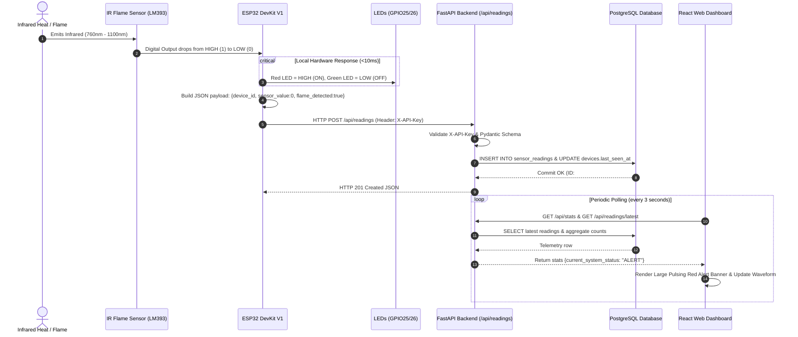

# System Architecture — IoT Fire Detection System

This document outlines the architectural design, telemetry pipeline, data flows, and state management of the **IoT Fire Detection System**.

---

## 1. High-Level Architecture Diagram

```mermaid
flowchart TD
    subgraph Hardware_Layer["Hardware Layer (Station)"]
        Sensor["IR Optical Flame Sensor (LM393)"] -->|Digital Active-LOW DO| ESP32["ESP32 DevKit V1 Microcontroller"]
        ESP32 -->|GPIO26 / 220Ω| RedLED["Red LED (Alert Indicator)"]
        ESP32 -->|GPIO25 / 220Ω| GreenLED["Green LED (Safe Indicator)"]
    end

    subgraph Network_Transport["Transport & Security"]
        ESP32 -->|Wi-Fi 802.11 b/g/n / HTTP POST JSON| Gateway["Wi-Fi Access Point / Router"]
        Gateway -->|HTTPS / X-API-Key Header| Cloud["Internet / Cloud Ingress"]
    end

    subgraph Cloud_Backend["Backend Layer (Render Web Service)"]
        Cloud --> FastAPIServer["FastAPI Application (Python 3.12)"]
        FastAPIServer --> AuthMid["API Key Auth Middleware (X-API-Key)"]
        AuthMid --> PydanticVal["Pydantic Telemetry Validator"]
        PydanticVal --> CRUD["SQLAlchemy 2.0 ORM Engine"]
    end

    subgraph Datastore["Persistence Layer (Render PostgreSQL)"]
        CRUD --> PG_Readings[("sensor_readings Table")]
        CRUD --> PG_Devices[("devices Table")]
        Alembic["Alembic Migrations Engine"] -.->|Schema Versioning| Datastore
    end

    subgraph Presentation_Layer["Frontend Layer (Render Static Site)"]
        PG_Readings --> FastAPIServer
        PG_Devices --> FastAPIServer
        FastAPIServer -->|REST JSON / CORS| ReactDashboard["React 19 + Vite Dashboard"]
        ReactDashboard --> PollEngine["Auto-Polling Engine (3s interval)"]
        ReactDashboard --> StatusComp["Dynamic Status Banner (Alert / Safe / Offline)"]
        ReactDashboard --> RechartsComp["Recharts Waveform Telemetry Visualizer"]
        ReactDashboard --> TableComp["Paginated Historical Telemetry Table"]
    end
```

---

## 2. Telemetry Ingestion Sequence

The diagram below details the sequence of events from when an optical flame is detected by the IR sensor module to when the alert reflects on the user's dashboard:



---

## 3. System States & Fail-Safe Logic

To ensure safety, the system implements a 4-state finite state machine on the backend and frontend:

| State | Condition | Frontend UI Reaction | Hardware Reaction |
|---|---|---|---|
| **ALERT** | `latestReading.flame_detected == true` AND device is online | Pulsing red critical warning banner, audio-visual siren badge, log row highlight | Red LED ON, Green LED OFF |
| **SAFE** | `latestReading.flame_detected == false` AND device is online | Calm emerald green panel ("System Armed • No Flame Detected") | Red LED OFF, Green LED ON |
| **OFFLINE** | No telemetry ping within `DEVICE_OFFLINE_THRESHOLD_SECONDS` (30s) | Amber warning panel ("Sensor Disconnected • Missing readings not safe") | Local hardware retains last known physical state |
| **NO_DATA** | Database table has 0 total records | Neutral slate banner awaiting initial telemetry packet | Self-test flash then idle |

> [!IMPORTANT]
> Missing telemetry packets are **never** treated as a safe condition. If an ESP32 is powered off or disconnected from Wi-Fi, the dashboard flags an **OFFLINE** state to prevent false security.
